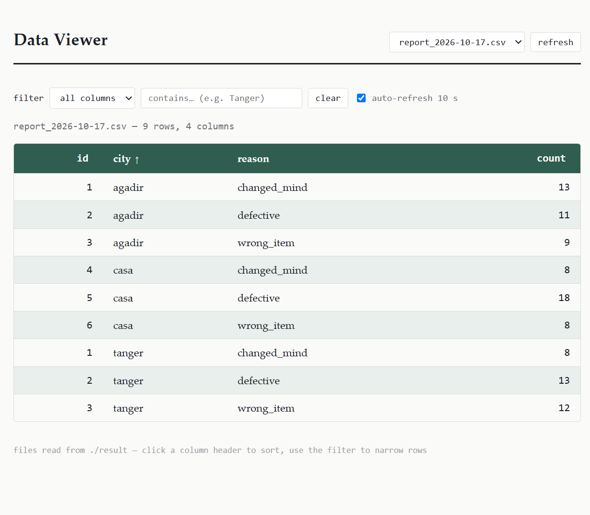

code
Markdown
# 📦 Returns Data Processing Pipeline & Live Viewer

[](https://www.docker.com/)
[](https://www.gnu.org/software/bash/)
[](https://github.com)

An automated, containerized ETL (Extract, Transform, Load) pipeline that ingests, cleans, validates, and aggregates retail return datasets across Moroccan cities (e.g., Agadir, Casablanca, Tanger), featuring an integrated web-based viewer for real-time monitoring and reporting.

Developed as part of the **DataMaroc - Data Engineering Bootcamp**.

---

## 📸 Overview & Dashboard Preview

The pipeline continuously processes incoming CSV files, validates schema integrity, discards incomplete/temporary files, aggregates metrics via optimized POSIX shell tools (`awk`, `bash`), and serves the consolidated metrics to a lightweight web viewer.


*(Drop your UI screenshot into `docs/viewer_preview.png`)*

---

## 🏗️ Architecture & Data Flow

```text
 incoming/
    ├── *.tmp       ───► [ Clean Stage ]  ───► trash/
    └── *.csv       ───► [ Ingestion & Schema Check ]
                               │
            ┌──────────────────┴──────────────────┐
        [Valid]                               [Invalid]
            │                                     │
      [ awk Aggregation ]                     errors/
            │
            ├──────► result/report_YYYY-MM-DD.csv ───► [ Web UI Viewer ]
            │
            └──────► archive/*_YYYY-MM-DD.csv
```

`Trash Cleanup`: Identifies leftover .tmp files in incoming/ and purges them to trash.

`Schema Validation`: Verifies that required columns (reason, city, etc.) exist before processing. Faulty files are isolated in errors.

`ETL / Aggregation (awk)`: Computes categorical return frequencies (changed_mind, defective, wrong_item) partitioned by city.

`Archiving`: Processed sources are renamed with execution datestamps and moved to archive/ to ensure idempotency and prevent duplicate records.

`Presentation Layer`: Outputs consolidated reports into result/ where the Dockerized HTTP service serves live data to users.

## 📂 Project Structure
```Bash
.
├── docker-compose.yml        # Multi-container orchestration
├── Dockerfile                # Container definition
├── process_returns.sh        # Core pipeline logic (Bash & Awk)
├── incoming/                 # Landing directory for raw returns data
├── result/                   # Consolidated reports (consumed by Web Viewer)
├── archive/                  # Processed raw files (timestamped)
├── errors/                   # Quarantine directory for bad schema files
├── trash/                    # Dropped temp files (.tmp)
├── logs/                     # Daily run logs (ISO-8601 timestamps)
└── web/                      # Lightweight Web Data Viewer interface
```
🚀 Getting Started
Prerequisites
Docker Desktop (v20+ recommended)
Docker Compose
Running with Docker (Recommended)
Clone the repository:
```Bash
git clone https://github.com/your-username/returns-processing-pipeline.git
cd returns-processing-pipeline
```
Launch the environment:
```Bash
docker compose up -d --build
```
Access the Web Viewer:
Open your browser at:
```Text
http://localhost:8080
🧪 Testing the Pipeline Manually
You can feed sample return files into the pipeline directly:
```
Drop sample data into incoming:
```Bash
cp samples/returns_agadir.csv incoming/
cp samples/returns_casa.csv incoming/
```
Trigger the processor:
```Bash
docker exec -it returns_pipeline bash ./process_returns.sh
./process_returns.sh
```
Check the outputs:
Report: cat result/report_$(date +%F).csv
Execution Logs: cat logs/run_$(date +%F).log
📊 Sample Output Format
Aggregated result stored in result/report_YYYY-MM-DD.csv:
id	city	reason	count
1	agadir	changed_mind	13
2	agadir	defective	11
3	agadir	wrong_item	9
4	casa	defective	18
...	...	...	...
🛠️ Tech Stack & Engineering Highlights
Shell Scripting (bash): Orchestrates directory lifecycles, error routing, and idempotency guarantees.
Stream Processing (awk): High-throughput, memory-efficient in-place aggregation without requiring heavy Python runtimes for basic ETL tasks.
Containerization (Docker): Fully reproducible runtime environment ensuring consistent execution across development and production systems.
Logging: Structured logging format ([TIMESTAMP] [LEVEL] MESSAGE) with standard error and output separation via tee.
